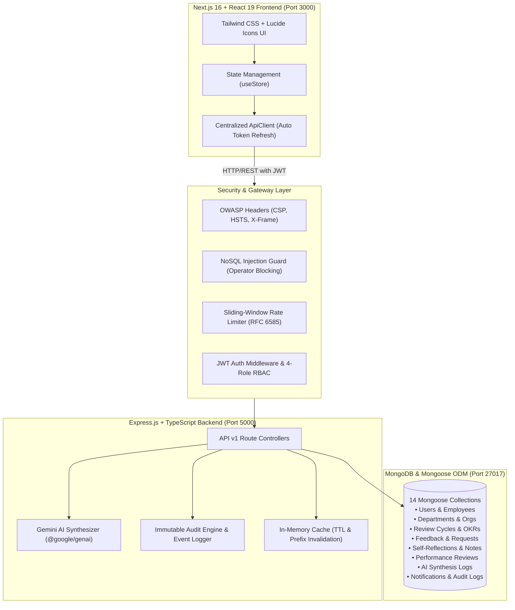

# ReviewForge — 360-Degree Performance Review Synthesizer

> **Enterprise-Grade AI-Powered Performance Synthesizer, 360-Degree Feedback & Talent Governance Platform**  
> Complete 15-Milestone SDLC Implementation & Verified Production Architecture.

---

## 1. System Overview

**ReviewForge** is an enterprise human capital management and performance synthesizer platform. It bridges continuous quarterly OKR tracking, multi-perspective 360-degree peer feedback, confidential managerial observations, and grounded generative AI review synthesis into a cohesive, auditable talent governance workflow.

Built strictly according to an uncompromising 15-milestone software development lifecycle (SDLC), every feature is backed by real MongoDB database persistence, 4-role cryptographic Role-Based Access Control (RBAC), multi-layer OWASP security hardening, and an automated regression test suite comprising **486 passing assertions across 14 test suites (100.0% pass rate)**.



---

## 2. Technology Stack

| Layer | Technologies | Description |
| :--- | :--- | :--- |
| **Frontend** | **Next.js 16**, **React 19**, **TypeScript 5.7**, **Tailwind CSS 3.4** | Modern, decoupled client with server and client components, accessible design system, and reactive stores. |
| **Backend** | **Node.js 20+**, **Express.js 5.2**, **TypeScript 5.7** | Decoupled ES Modules backend with modular controllers, validation middleware, and RESTful routing. |
| **Database** | **MongoDB 7.0+**, **Mongoose 9.1** | Schema enforcement, compound unique indexes, optimistic concurrency, and automated data seeders. |
| **AI Synthesis** | **Google Gemini API** (`@google/genai`) | Multi-source grounded generation with structured JSON schema outputs, evidence cross-validation, and hallucination guards. |
| **Security** | **Jose**, **Bcryptjs**, **Zod 3.24** | 15-min JWT access tokens, 7-day refresh tokens with `jti` nonces, salted password hashes, and strict payload validation. |

---

## 3. Architecture & Project Structure

The project employs a clean, decoupled architecture where the Next.js frontend (`client/`) and Express.js backend (`server/`) operate independently:

```
reviewforge/
├── client/                           # Next.js 16 Decoupled Frontend
│   ├── src/
│   │   ├── app/                      # Next.js App Router Pages
│   │   │   ├── (auth)/               # Login, Forgot Password, Reset Password
│   │   │   └── (workspace)/          # Dashboard, Employees, Reviews, Feedback, OKRs, Settings
│   │   ├── components/               # UI Design System & Role-Aware Components
│   │   ├── lib/
│   │   │   ├── api-client.ts         # Centralized API Client with Token Rotation
│   │   │   └── storage/use-store.tsx # Global Reactive Store & Session Restoration
│   │   └── types/                    # Shared TypeScript Domain Interfaces
│   ├── package.json
│   └── tsconfig.json
├── server/                           # Express.js Decoupled Backend
│   ├── src/
│   │   ├── config/                   # Database (Mongoose), Environment & Index Optimization
│   │   ├── controllers/              # RESTful Business Logic Controllers
│   │   ├── middleware/               # Auth (RBAC), Security Headers, Rate Limiting, Validation
│   │   ├── models/                   # 14 Mongoose Schema Definitions & Initial Seeders
│   │   ├── routes/                   # API v1 Route Registrations
│   │   ├── services/                 # Gemini AI Performance Review Synthesis Service
│   │   ├── utils/                    # JWT Token Utilities, Privacy Sanitization, In-Memory Cache
│   │   └── app.ts                    # Express Application Factory
│   ├── tests/                        # 14 Automated Test Suites (486 Passing Assertions)
│   ├── package.json
│   └── tsconfig.json
├── docs/                             # Full Engineering Documentation Suite
│   ├── ARCHITECTURE.md               # Decoupled Architectural Blueprint
│   ├── API_DOCUMENTATION.md          # Complete REST API Specifications
│   ├── BUG_TRACKER.md                # 33 Tracked & Resolved System Issues
│   ├── DATABASE_SCHEMA.md            # Mongoose Schema & Index Reference
│   ├── MILESTONE_STATUS.md           # 15-Milestone Status Matrix
│   └── RBAC_MATRIX.md                # Role-Based Permission Control Specifications
├── package.json                      # Root Orchestration Scripts
└── README.md                         # Master Documentation & Setup Guide
```

---

## 4. Default Enterprise Test Credentials

ReviewForge comes pre-seeded with 4 default enterprise role test accounts covering the complete corporate hierarchy:

| Role | Name | Email | Default Password | Permission Level |
| :--- | :--- | :--- | :--- | :--- |
| **HR Administrator** | ReviewForge HR Admin | `admin@reviewforge.io` | `Admin@ReviewForge2026!` | Full administrative access, cycle management, review publishing, audit inspection. |
| **Manager** | Elena Rostova (Eng Manager) | `elena.rostova@reviewforge.io` | `Admin@ReviewForge2026!` | Scoped to direct reports, submits reviews, drafts private notes, reviews team OKRs. |
| **Employee** | Rahul Deshmukh (Frontend Eng) | `rahul.deshmukh@reviewforge.io` | `Admin@ReviewForge2026!` | Self-assessments, OKR progress updates, views released reviews only. |
| **Peer Reviewer** | Marcus Vance (Senior Reviewer)| `marcus.vance@reviewforge.io` | `Admin@ReviewForge2026!` | Completes assigned 360-degree peer feedback questionnaires. |

---

## 5. Quick Start Guide (Local Terminal)

Follow these steps to start ReviewForge from your local terminal.

### Prerequisites
1. **Node.js**: v20.x or higher installed.
2. **MongoDB**: Local MongoDB community edition running on `127.0.0.1:27017` or a MongoDB Atlas URI.

### Step 1: Start MongoDB
Ensure your local MongoDB service is running:
```powershell
# On Windows (Run PowerShell as Administrator if needed):
net start MongoDB

# Or if running MongoDB manually via mongod:
mongod --dbpath "C:\data\db"
```

### Step 2: Configure Environment Variables
Verify or create the environment configuration in `server/.env`:
```env
PORT=5000
NODE_ENV=development
MONGODB_URI=mongodb://127.0.0.1:27017/reviewforge
JWT_SECRET=reviewforge-super-secret-jwt-key-2026-production
JWT_REFRESH_SECRET=reviewforge-super-secret-refresh-key-2026-production
JWT_EXPIRES_IN=15m
JWT_REFRESH_EXPIRES_IN=7d
CORS_ORIGIN=http://localhost:3000
GEMINI_API_KEY=your_gemini_api_key_here
```

### Step 3: Install Dependencies
```powershell
# From the repository root:
npm run install:all
```

### Step 4: Build & Start the Backend Server
```powershell
# In a dedicated terminal:
cd server
npm run build
npm start
```
*The server will boot on `http://localhost:5000`, connect to MongoDB, verify all database collection indexes, and seed initial baseline data.*

### Step 5: Start the Next.js Frontend
```powershell
# In a second terminal:
cd client
npm run dev
```
*The frontend will start at `http://localhost:3000`. Navigate to `http://localhost:3000/login` to sign in.*

---

## 6. Automated Testing & Verification

ReviewForge includes an exhaustive, multi-tier automated test suite covering all 15 development milestones:

```powershell
# Run the entire master regression suite (486 tests):
npm test --prefix server

# Run individual milestone test suites:
npm run test:auth --prefix server            # M3: Authentication & RBAC (20 tests)
npm run test:employee --prefix server        # M4: Employee Management (26 tests)
npm run test:department --prefix server      # M5: Organization & Departments (22 tests)
npm run test:review-cycle --prefix server    # M6: Review Cycle Configuration (25 tests)
npm run test:feedback --prefix server        # M7: 360-Degree Feedback & Anonymity (34 tests)
npm run test:okr --prefix server             # M8: OKR & Progress Calculation (30 tests)
npm run test:manager-note --prefix server    # M9: Manager Observations & Notes (41 tests)
npm run test:ai --prefix server              # M10: AI Performance Synthesizer (48 tests)
npm run test:workflow --prefix server        # M11: Review Approval & Publishing (46 tests)
npm run test:analytics --prefix server       # M12: Dashboards & CSV Export (57 tests)
npm run test:notifications --prefix server   # M13: In-App Notifications & Audit Trail (52 tests)
npm run test:security --prefix server        # M14: OWASP Security & Rate Limiting (50 tests)
npm run test:e2e --prefix server             # M15: Complete End-to-End System Integration (27 tests)
```

### Test Suite Execution Summary
- **Total Test Suites**: 14 suites
- **Total Assertions**: 486
- **Passed**: 486 (100.0%)
- **Failed**: 0

---

## 7. Key Features by Milestone

1. **Milestone 1 — Codebase Inspection**: Comprehensive audit and preservation of baseline UI assets.
2. **Milestone 2 — Project Setup & Architecture**: Clean decoupled Next.js + Express + Mongoose architecture with Zod schema validation and centralized error handlers.
3. **Milestone 3 — Authentication & RBAC**: Salted Bcrypt password hashing, JWT token rotation with cryptographic `jti` nonces, and 4-role permission gates (`hr_admin`, `manager`, `employee`, `peer_reviewer`).
4. **Milestone 4 — Employee Management**: Enterprise employee directory with search, filtering, pagination, manager hierarchy assignment, and soft deactivation.
5. **Milestone 5 — Department & Organization Management**: Department governance, budget tracking, head assignments, and multi-tenant data isolation.
6. **Milestone 6 — Review Cycle Management**: Annual review cycles, milestone scheduling, questionnaire configuration, and assignment management.
7. **Milestone 7 — 360-Degree Feedback**: Peer evaluations, manager assessments, self-reflections, and cryptographic identity masking for reviewer anonymity.
8. **Milestone 8 — Quarterly OKR Management**: Objective and Key Result tracking with automated progress weighting and real-time metric recalculation.
9. **Milestone 9 — Manager Notes & Assessments**: Private manager observations with competency rubric evaluations and strict access isolation.
10. **Milestone 10 — AI Performance Review Synthesizer**: Gemini API integration with structured JSON responses, multi-source evidence grounding, citation tracking, and 503 operational guards when credentials are not configured.
11. **Milestone 11 — Review Approval & Publishing Workflow**: Multi-stage review lifecycle (`Draft` $\to$ `Submitted` $\to$ `Approved` $\to$ `Released`), change request loops, and employee confidentiality gates.
12. **Milestone 12 — Talent Analytics & Dashboards**: Real-time role-scoped dashboards, organizational performance charts, attention queues, and streaming CSV/JSON export.
13. **Milestone 13 — Notifications & Audit Logs**: Live in-app notifications with unread counts and append-only immutable security audit logs (HTTP 405 on tamper attempts).
14. **Milestone 14 — Security Hardening & Performance Optimization**: OWASP security headers, recursive NoSQL injection guards, RFC 6585 sliding-window rate limiters, database index optimization, and in-memory TTL caching.
15. **Milestone 15 — Complete System Integration & Handover**: Complete 14-phase end-to-end integration verification, cumulative regression passing at 100%, and full system documentation.

---

## 8. Primary API Endpoints Reference

| Module | Method | Endpoint | Access Role | Description |
| :--- | :--- | :--- | :--- | :--- |
| **System** | `GET` | `/api/v1/health` | Public | System status, MongoDB readiness, collection counts. |
| **Auth** | `POST` | `/api/v1/auth/login` | Public | Authenticates credentials, returns access & refresh tokens. |
| **Auth** | `POST` | `/api/v1/auth/refresh` | Public | Rotates access token via valid refresh token. |
| **Auth** | `GET` | `/api/v1/auth/me` | Authenticated | Retrieves current authenticated user profile. |
| **Employees** | `GET` | `/api/v1/employees` | Authenticated | Paginated employee directory with search & department filters. |
| **Employees** | `POST` | `/api/v1/employees` | `hr_admin` | Creates new employee record with auto-increment ID. |
| **Review Cycles**| `GET` | `/api/v1/review-cycles` | Authenticated | Lists all configured performance review cycles. |
| **Review Cycles**| `POST` | `/api/v1/review-cycles` | `hr_admin` | Creates new review cycle with customized deadlines. |
| **Feedback** | `GET` | `/api/v1/feedback` | Authenticated | Queries 360-degree feedback (anonymized for employees). |
| **Feedback** | `POST` | `/api/v1/feedback` | Authenticated | Submits peer evaluation with rating dimensions. |
| **OKRs** | `GET` | `/api/v1/okrs` | Authenticated | Retrieves quarterly OKRs and key results. |
| **Manager Notes**| `GET` | `/api/v1/manager-notes` | `manager`, `hr_admin`| Scoped confidential manager observations. |
| **AI Synthesis** | `POST` | `/api/v1/ai/synthesize` | `manager`, `hr_admin`| Generates multi-source grounded performance review draft. |
| **Reviews** | `GET` | `/api/v1/reviews` | Authenticated | Retrieves performance reviews (redacted if unreleased). |
| **Reviews** | `POST` | `/api/v1/reviews/:id/submit`| `manager` | Submits draft review to HR for approval. |
| **Reviews** | `POST` | `/api/v1/reviews/:id/approve`| `hr_admin`| Formally approves performance review. |
| **Reviews** | `POST` | `/api/v1/reviews/:id/publish`| `hr_admin`| Releases review to employee view. |
| **Analytics** | `GET` | `/api/v1/analytics/dashboard`| Authenticated | Real-time role-scoped performance analytics. |
| **Analytics** | `GET` | `/api/v1/analytics/export` | `hr_admin`, `manager`| Streams CSV/JSON organizational report. |
| **Notifications**| `GET` | `/api/v1/notifications`| Authenticated | Queries user notifications with live unread counts. |
| **Audit Logs** | `GET` | `/api/v1/audit-logs` | `hr_admin` | Queries immutable security audit trail. |
| **Security** | `GET` | `/api/v1/security/status` | `hr_admin` | Audits platform security posture and index health. |

---

## 9. License

Proprietary enterprise software developed for **ReviewForge**. All rights reserved.
